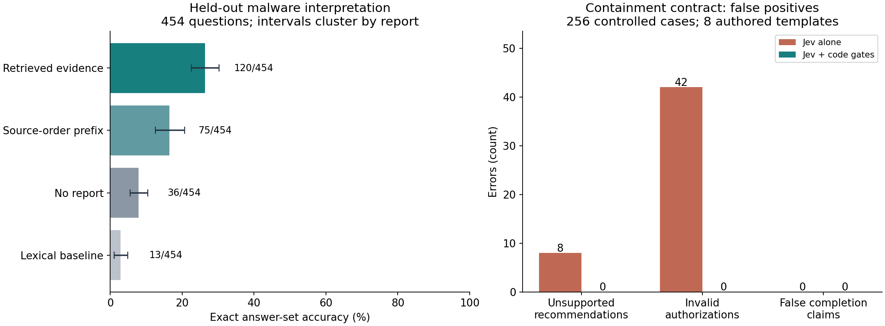
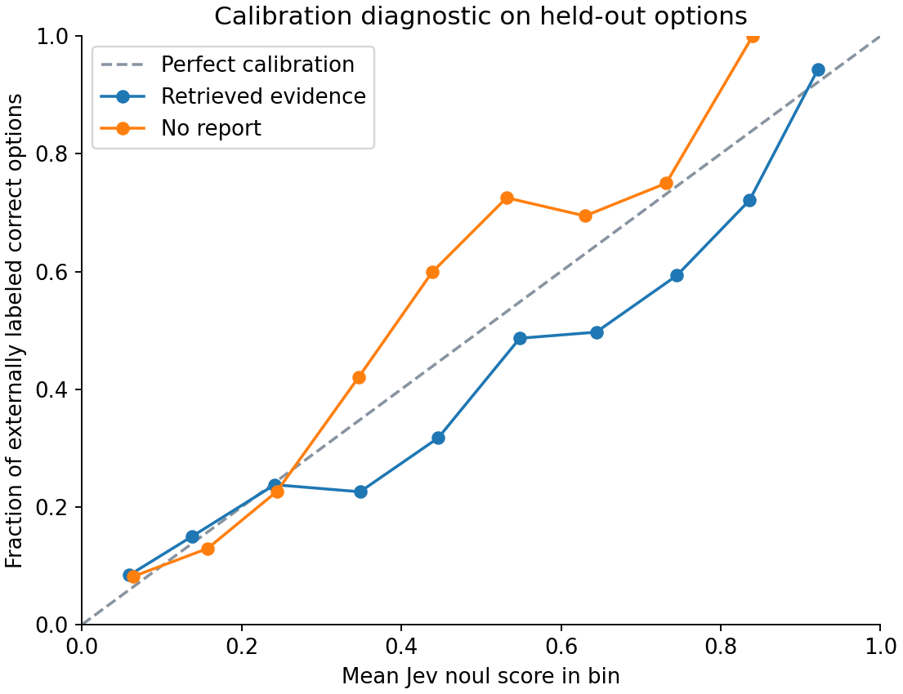
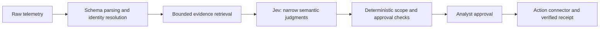

# Where Jev fits in an SOC pipeline

**Takeaway:** Jev is most promising as a fast, narrowly scoped semantic classifier with curated evidence. Keep exact identity resolution, timestamps, approval checks and action verification in deterministic code. This evaluation does not support giving it broad investigation or containment authority.

Evaluation completed **October 4, 2026**, using **`jev-1.13.0`**. We made **3,364 successful API calls**, used **25,102,078 input tokens**, and estimated **$1.05** in inference cost. These are calls, not independent incidents.

## Results at a glance

| Pipeline stage | Observed result | Takeaway |
|---|---|---|
| Narrow compromise judgment | **256/256** correct in controlled cases | Promising for explicit semantic predicates; the cases were authored, not a production sample |
| Recorded cloud event type | **122/122** correct | Good observed handling; a schema parser also succeeds without inference cost |
| Actor ID when present | **118/122** correct | Exact identifiers still need validation |
| Actor ID when missing | **54/122** unsupported selections | A plausible identifier must not become an action target |
| Malware evidence interpretation | **120/454 (26.4%)** complete answer sets | Too unreliable for broad unsupervised analysis in this adapter |
| Agent-controlled investigation | **12/60** correct versus **16/60** with fixed retrieval | No demonstrated benefit from model-selected evidence tools |
| Containment recommendation | **248/256** correct; **8** unsupported recommendations | All eight ignored the target-verification requirement |
| Containment authorization | Approved **42/144 invalid requests** and denied **16/112 valid requests** | Enforce the contract in code |
| Jev plus deterministic policy checks | **256/256** correct authorization decisions | The gate fixes these controlled policy failures; it does not certify production safety |

The left chart shows exact-set accuracy with 95% confidence intervals resampling report clusters. The right chart shows fixed-suite error counts from authored policy cases. These are different populations and should not be combined into one score.

## What we tested

- **609 external, expert-reviewed malware questions over 175 real sandbox reports**, from [CyberSOCEval](https://arxiv.org/abs/2509.20166). Development used 155 questions from 45 reports; test used 454 questions from 130 different reports.
- **122 public Azure, Okta and Exchange records**, plus 122 matched copies with the authoritative actor field removed. The task was exact field handling, not classifying every record as malicious.
- **256 containment-contract cases:** eight incident templates, each with 32 conditions covering stale or future evidence, missing approvals, wrong targets/actions, UTC offsets, target versions and execution receipts.
- **60 agent episodes** with up to four read-only evidence tools. Early stopping was allowed; success depended on the final answer, not reading every tool.
- **60 paired cases per robustness variant**, plus identical-input controls.

The primary plan was frozen before API calls. Thresholds were chosen using development data before test requests. Raw requests, responses, labels, source hashes and item scores are preserved. The additional compact-evidence adapter and repeat controls are explicitly exploratory follow-ups.

## Where the largest gaps are

### 1. Complete evidence interpretation remains weak

| Evidence supplied | Exact answers on the 454-question test set |
|---|---:|
| Query-ranked report excerpts | **120/454 — 26.4%** |
| Source-order report excerpts | **75/454 — 16.5%** |
| No report | **36/454 — 7.9%** |
| Lexical option-matching baseline | **13/454 — 2.9%** |
| Compact evidence index, exploratory follow-up | **137/454 — 30.2%** |

Retrieval helps: query-ranked evidence improves on no report by **18.5 percentage points**. Its exact-set accuracy has a report-cluster 95% interval of **22.6–30.3%**.

The compact adapter retains all technique and signature-name indexes and raises accuracy by **3.7 points**. It was designed after inspecting primary failures, so this is not a fresh confirmatory holdout. Better preprocessing explains part of the weakness, but does not resolve it.

Some benchmark questions have overlapping answers or “all of the above” conventions. Excluding those 71 questions leaves **101/383 (26.4%)**, so the overall shortfall remains. These are scores for our typed-output/context adapter, not official CyberSOCEval leaderboard scores.

### 2. Missing identity evidence invites unsupported choices

When the authoritative actor ID was removed, Jev selected another candidate in **54 of 122 cases**. Fourteen wrong choices had reported confidence of at least 0.8. Other identifiers in an event—tenant, application or affected object—are not interchangeable with the requested initiating actor.

A separate known-schema parser achieved **244/244** exact three-field results after two parser implementation bugs were repaired. That repair, and the ambiguous Okta `ALLOW` outcome mapping, are documented in the [case audit](rigorous/CASE_AUDIT.md).

**Operational implication:** preserve UNKNOWN and resolve the entity before considering containment. A high model score cannot establish identity.

### 3. Approval and time boundaries need exact enforcement

At threshold 0.5, Jev approved **42/144 requests that violated policy**. This included every eight-case group with:

- approval starting one second in the future;
- evidence 901 seconds old against a 900-second limit;
- evidence timestamped one second in the future;
- an unverified action target.

It also denied all eight valid UTC-offset cases. Raising the threshold to 0.8 still produced **30 invalid approvals**, while missing **30 valid approvals**. Tightening the threshold does not replace a policy engine.

The hybrid pipeline used the same Jev compromise judgment and deterministic checks for the remaining conditions. It made **zero invalid approvals** in this suite. This is evidence for explicit enforcement, not a measured real-world false-containment rate.

### 4. Tool selection did not demonstrate an advantage

Jev-selected evidence gathering answered **12/60** cases correctly, compared with **16/60** using fixed retrieval. The paired difference was **−6.7 points**, with a 95% interval of **−18.3 to +5.0**; the comparison is inconclusive.

The agent averaged **2.13 reads / 3.13 API calls** per episode. Token consumption was nearly identical: **704,621 agent tokens** versus **703,178 fixed-retrieval tokens** across the same 60 questions. Extra round trips did not produce a demonstrated accuracy benefit.

### 5. Confidence and stability need scrutiny

In the retrieval arm, requiring every option to have binary confidence at least 0.8 accepted only **28/454 questions**; **22/28** were exactly correct. This is low coverage and still imperfect accuracy. The plotted bins are descriptive; they do not establish calibrated production probabilities.

Identical-input repeats changed **7/60 answer sets**, compared with **8/60 under injection**. We therefore cannot attribute every injected change to the attacker. Six fixed attack templates and a weak clean-task baseline do not establish broad injection resistance or vulnerability.

## Recommended architecture

Use Jev to interpret a bounded observation or assess an explicit candidate. Keep authoritative identifiers, dates, target versions, approval scope and completion verification outside the model. Prioritize reliable evidence preparation before adding more agent-controlled steps.

Primary API latency was **170 ms median / 240 ms p95**, measured at the client. That excludes retrieval and real SOC connector latency. The low inference cost is attractive, but the evaluation does not measure analyst time saved or compare Jev with a stronger model on identical inputs.

## Limits and next evidence needed

The reports already contain sandbox signatures, AV verdicts and MITRE annotations: this evaluates interpretation of enriched evidence, not raw malware detection. Public training-data contamination cannot be excluded. Question templates overlap across development and test even though report IDs do not. Policy cases are authored and cloud records come from only eight public datasets.

We also audited SOCBench network flows and excluded them: normal and malware captures have different protocol/missing-packet schemas and timestamp eras. A misleadingly strong classifier could exploit collection artifacts. See the [source audit](rigorous/SOURCE_AUDIT.md).

Before production use, collect a private, time-separated mixed-enterprise alert set at the actual alert base rate, use two SOC reviewers with adjudication, and run a shadow pilot. Measure false containment, target-identity errors, missed incidents, analyst minutes saved and risk at each abstention level. Include both rules-only and stronger-model comparisons on identical evidence.

All **3,364** saved responses passed schema/version checks, and the original **50 evaluation tests** passed. The repository adds setup-integrity tests and CI; no new hosted evaluation is needed to validate the recorded findings. For complete methods, intervals and artifacts, see [the full report](rigorous/REPORT.md), [validation record](rigorous/VALIDATION.md), [raw metric tables](rigorous/results/metrics.json) and [notebook](rigorous/analysis.ipynb).
