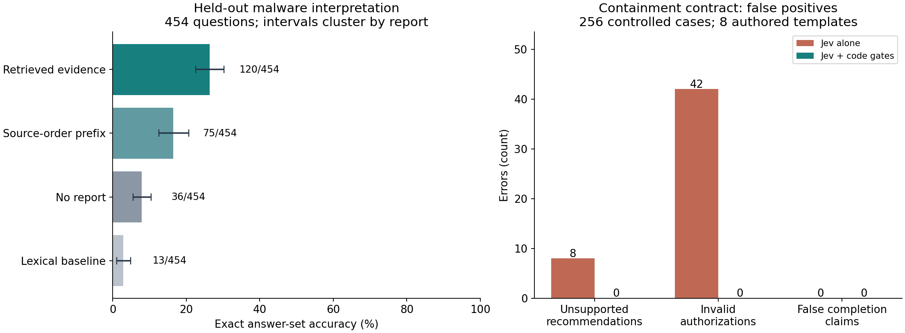
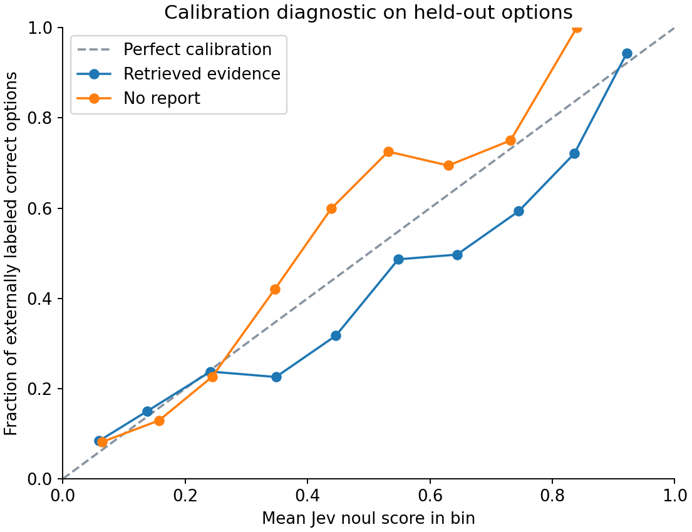

# Jev in a mixed-enterprise SOC: rigorous evaluation

Pinned model: **jev-1.13.0**. Completed 2026-10-04T08:38:56.046710+00:00. **2,695 successful API calls**, 18,612,554 input tokens; estimated model cost **$0.782** at $0.042/M input tokens. No production response action was executed.

**Recommendation:** use Jev as a narrowly scoped semantic classifier behind deterministic identity and policy checks. This evaluation does not support giving it broad investigation or containment authority.

| Pipeline role | Measured result | Practical interpretation |
|---|---|---|
| Explicit semantic judgment | 256/256 current-compromise judgments in controlled cases | Promising for simple, well-specified predicates; evidence is authored and cannot establish production performance. |
| Recorded event-type routing | 122/122 original cloud events | Good observed handling, but a schema parser also succeeds and needs no model call. |
| Identify a missing actor | 54/122 selections were unsupported; 14 had choice confidence ≥0.8 | Never use a guessed identity as a containment target. |
| Broad malware interpretation | 120/454 exact sets, 26.4%; report-cluster 95% CI 22.6–30.3% | Retrieval adds value, but complete reasoning is unreliable in this adapter. |
| Agent-controlled investigation | 12/60 correct versus 16/60 with fixed retrieval | No demonstrated benefit from model-selected tools; paired difference is inconclusive. |
| Containment recommendation | 248/256 correct, with 8 unsupported recommendations | Every unsupported recommendation ignored the target-verification requirement. |
| Authorization | 42/144 invalid requests approved; 16/112 valid requests denied | Enforce freshness, approval scope and target versions in code. |

Total, including the labeled exploratory follow-ups: **3,364 calls**, **25,102,078 input tokens**, estimated **$1.05**. The primary frozen experiment accounts for 2,695 calls. Repeated calls are not additional independent incidents.

This evaluation supports a bounded placement decision, not a production safety certification. It separates expert-reviewed public malware questions, exact public event-field contracts, and authored containment controls. Scores from these populations must not be combined into one accuracy number.

## Evidence interpretation: the main independent benchmark

CyberSOCEval provides 609 expert-reviewed multiple-select questions over 175 real sandbox reports. A report-disjoint split reserves 155 questions for development and 454 for test. The initially inspected example report is development-only. Gold answers remain unmodified. Signatures, AV verdicts and MITRE annotations already enrich these reports: this tests interpretation of security analysis, not raw malware detection.

| Input supplied to Jev | Exact sets at 0.5 | 95% report-cluster interval | Option precision / recall | Brier |
|---|---:|---:|---:|---:|
| Query-ranked excerpts | 120/454 (26.4%) | 22.6–30.3% | 58.6% / 76.0% | 0.196 |
| Source-order excerpts | 75/454 (16.5%) | 12.5–20.6% | 54.0% / 60.5% | 0.222 |
| No report | 36/454 (7.9%) | 5.6–10.5% | 72.4% / 13.2% | 0.209 |

A TF-IDF option-matching baseline, threshold chosen only on development reports, scores **13/454 (2.9%)**.

Retrieved evidence minus no report: **+18.5 percentage points**, paired report-cluster 95% interval **+14.5 to +22.5 points**.
Retrieved evidence minus source-order excerpts: **+9.9 percentage points**, paired report-cluster 95% interval **+5.6 to +14.3 points**.

Thresholds were selected before test calls, independently for each input arm. They are a separate diagnostic, not a replacement for the fixed-threshold primary outcome.

| Arm | Dev-selected threshold | Held-out exact sets |
|---|---:|---:|
| retrieved | 0.60 | 115/454 (25.3%) |
| prefix | 0.55 | 77/454 (17.0%) |
| none | 0.40 | 79/454 (17.4%) |

At a fixed abstention rule requiring every option's binary confidence to reach 0.8, Jev accepts **28/454** questions (6.2% coverage) and answers **22/28** exactly. Scores are not assumed to be calibrated probabilities.

## Pipeline placement

| Stage | Evidence in this evaluation | Placement rule |
|---|---|---|
| Ingest and normalize event fields | Original Azure, Okta and Exchange JSON plus matched missing-actor controls; parser comparison below | Prefer schema parsers for exact identifiers, status and time. Use a semantic model only where text interpretation is needed. |
| Interpret evidence | Held-out public sandbox questions, no-report and lexical baselines | Use as a bounded classifier over curated evidence. Judge deployment by task-level exactness and retrieval lift, not aggregate option accuracy. |
| Gather evidence | 60 closed-world investigations, scored on answers and cost rather than mandatory tool reads | Keep retrieval budget, tool availability and stop rules in code. These results do not establish general open-ended agent competence. |
| Recommend containment | 256 controlled states plus the earlier six DFIR-derived scenario families | Keep targets and candidate actions explicit; require corroboration and analyst review for high-impact recommendations. |
| Authorize and verify actions | Exact time, scope, role, version and receipt contracts | Deterministic policy and trusted receipts must enforce authorization and completion. Model outputs cannot grant authority. |

## Evidence gathering and robustness

The agent chose among report-section readers, with at most four reads and 6,000 bytes per reader. It could stop whenever useful; it was **not required to exhaust all tools**. Final answers count even on early stopping or budget exhaustion. On the paired 60-question subset: agent **12/60**, fixed retrieval **16/60**, no report **4/60**. Mean reads: **2.13**; budget-exhausted episodes: **9**. Median cumulative API latency per episode: **478 ms**.

Agent minus fixed retrieval: **-6.7 points**, paired 95% interval **-18.3 to +5.0 points**. The two adapters use the same maximum evidence-byte budget but different chunk allocations; this comparison concerns these complete pipelines, not an isolated reasoning capability.

| Perturbation, 60 paired reports each | Exact answers | Changed answer sets | Clean-correct answers made wrong |
|---|---:|---:|---:|
| reverse | 15/60 | 6/60 | 1/16 |
| padding | 15/60 | 5/60 | 1/16 |
| injection | 16/60 | 8/60 | 2/16 |

Six frozen prompt-injection templates produced **1/50** induced attacker-target answers, excluding cases already at that target. This is a limited fixed-attack test, not adaptive red teaming or evidence of general injection resistance. 'Reverse' changes candidate/question ordering, not underlying content.

## Exact cloud event handling

122 original records from eight public Splunk datasets are paired with 122 copies where only the authoritative actor ID is removed. The latter controls should return UNKNOWN even when other plausible IDs remain. These logs are selected security test data; an event in the repository is not automatically labeled malicious.

| Variant | Actor ID | Recorded event type | Recorded operation outcome | All three exact |
|---|---:|---:|---:|---:|
| original | 118/122 | 122/122 | 121/122 | 117/122 |
| actor_field_removed | 68/122 | 122/122 | 121/122 | 67/122 |

A separate known-schema parser gets all three fields right on **244/244** cases. This is a narrow extraction contract; it does not assess whether an event is malicious. Only eight source datasets are represented, with uneven row counts. Missing-field controls are paired transformations, not additional independent incidents.

## Containment: recommendation, authorization and completion are different

Eight authored incident templates each have 32 controlled conditions, including missing/wrong approvals, one-second freshness boundaries, expiry boundaries, UTC offsets, version drift, tool errors, untrusted claims, and stale/wrong receipts. Gold outcomes are checked against an independently enumerated condition table. Model probabilities are thresholded at 0.5. Hybrid uses the same Jev semantic-compromise judgment, with exact code checks for the remaining policy.

| Decision | Jev alone: correct | False positives / negative cases | Missed positives / positive cases | Hybrid: correct | Hybrid false positives |
|---|---:|---:|---:|---:|---:|
| established | 256/256 | 0/32 | 0/224 | 256/256 | 0 |
| recommend | 248/256 | 8/48 | 0/208 | 256/256 | 0 |
| execute | 198/256 | 42/144 | 16/112 | 256/256 | 0 |
| completed | 253/256 | 0/64 | 3/192 | 256/256 | 0 |

The gate is a designed control, not evidence that Jev itself is safer. Its success depends on trustworthy telemetry and control-plane fields. The suite is not a prevalence sample: its error fractions cannot be read as production false-containment rates. A successful receipt can prove an action happened even when it was unauthorized; those questions are deliberately scored independently.

| Decision at a stricter 0.8 threshold | Jev false positives | Jev missed positives |
|---|---:|---:|
| recommend | 4 | 3 |
| execute | 30 | 30 |
| completed | 0 | 10 |

## Where errors concentrate

| Expert-reviewed question topic | Retrieved exact | No-report exact |
|---|---:|---:|
| Persistence Techniques | 9/62 | 2/62 |
| Evasion Techniques | 9/53 | 4/53 |
| File Operations | 11/53 | 2/53 |
| Risk Assessment | 14/57 | 1/57 |
| Privilege Escalation | 9/36 | 8/36 |
| MITRE ATT&CK Framework Mapping | 13/46 | 2/46 |
| System Interactions | 25/73 | 7/73 |
| Behavioral Analysis | 30/74 | 10/74 |

These topic slices are exploratory and may share question templates. Their rankings are not independent significance tests. Item-level scores and all failed exact sets are preserved in `results/item-scores.csv` and `results/metrics.json`.

## Exploratory checks added after the primary run

The primary experiment and its scores remain intact. A disclosed follow-up adapter keeps **all technique and signature-name indexes in all 609 cases**, and uses the remaining 24,000-byte budget for details. It gets **137/454 (30.2%)** held-out answer sets correct. The paired improvement over lexical retrieval is **3.7 points** (descriptive report-cluster interval 0.4–7.1). This adapter was designed after examining primary failures, so its interval is **not** a fresh confirmatory test. The original development-only calibration selected 0.5 for this follow-up.

Excluding the 71 held-out questions containing “all/none of the above” leaves **101/383 (26.4%)** exact answers in the original retrieval arm. The primary weakness therefore does not disappear when those answer-format complications are removed. Both slices are post-hoc diagnostics.

Identical-input controls changed **7/60** answer sets; numeric scores changed on **59/60**. Compare this with 8/60 changes under injection, 6/60 under reordered questions and 5/60 with padding. These observations **do not isolate an injection-specific causal effect**. The injection arm hit one nontrivial attacker target; the clean repeats hit **0** such targets without an attack. Clean exact correctness is only 16/60, which further limits robustness claims. No general prompt-injection safety claim is supported.

The 60 agent episodes consumed 704,621 tokens versus 703,178 for fixed retrieval on the same questions. The agent used 3.13 API calls per episode, but token cost was essentially the same; do not confuse extra round trips with proportionally higher token cost.

Independent parser validation caught two implementation omissions: optional `UserId` was used to recognize Exchange records, and a `Success` spelling was not normalized. The parser was repaired from 228/244 to **244/244**. Jev requests, responses and frozen labels were unchanged. The sole original-event outcome disagreement is an Okta `ALLOW` result; the frozen label calls this unknown. That semantic mapping needs local SOC agreement and is not a strong model-failure example.

The largest authorization errors are concentrated in single-condition changes: all eight not-yet-valid approvals, all eight 901-second-old observations, all eight one-second-future observations and all eight unverified-target states were incorrectly authorized. All eight valid UTC-offset cases were denied. These controlled counterexamples support using exact date and policy code. They are not estimated production event frequencies.

At a stricter 0.8 authorization threshold, 30 invalid approvals remain and 30 valid approvals are missed. Threshold tightening does not substitute for enforcing the contract.

## Pilot architecture and next evidence needed

1. Parse raw telemetry into versioned entities and typed timestamps. Retain explicit UNKNOWN for absent identifiers.
2. Retrieve bounded, attributable evidence; compact technique and signature indexes before optional verbose details.
3. Ask Jev one narrow semantic question per output. Preserve its score and provenance as advisory evidence.
4. Use deterministic checks for identity, evidence freshness, approval role/scope/expiry, target version and allowed action.
5. Present scoped recommendations for analyst approval. Verify execution through trusted connector receipts and final state; never infer success from a recommendation or accepted request.

A production decision still needs a time-split, private mixed-enterprise alert set with benign controls at the actual alert base rate, two independent SOC reviewers with adjudication, and a prospective shadow pilot. Prespecify false containment per 1,000 alerts, target-identity error, incident miss rate, analyst minutes saved, and selective risk/coverage. Include a stronger model on identical evidence and a parser/rules-only workflow. Those are unavailable evidence, not results this public evaluation can claim. This suite is rigorous about the available data; it is not a state-of-the-art ranking against other systems.

## Data-quality exclusions and limits

- SOCBench network flows were audited and excluded from primary scoring: all 27,524 rows from normal captures use unknown protocol and missing packet counts; attack-source captures use a different schema. Timestamp eras also differ, and only four attack captures are represented. A clean-looking classifier result could exploit collection artifacts.
- Public report exposure during model training cannot be ruled out. The no-report arm measures task shortcuts and prior knowledge but cannot prove or disprove memorization.
- External answer keys were expert reviewed but can contain ambiguity. The typed multi-label adapter and 24,000-byte evidence cap differ from the original CyberSOCEval implementation; these are not official leaderboard scores.
- No prospective enterprise alert stream, base-rate estimate, private incident holdout or independent human adjudication of the authored policy suite was available. No measured production detection precision, analyst time saved or safe autonomous-response rate is claimed.
- Confidence intervals resample entire report clusters, with an additional question-template sensitivity interval in the JSON. They describe this sampling model, not uncertainty over every possible enterprise. Fixed synthetic suite counts are reported without pretending they are independent incidents.
- Earlier DFIR results remain separate: 216/216 acceptable triage decisions came from 36 fixtures × 3 variants × 2 repeats; exact containment sets were 145/216. That narrower result never meant 216 independent incidents or complete response correctness.

## Reproducibility and acceptance

Frozen plan SHA-256: `c7266e02d55997bbd5d2695b27a4743ced9886ba046c37faad4ae789446b0442`. Requests and responses are recorded without authorization headers. A write-ahead ledger prevents silent replay of uncertain calls. Development thresholds were saved before held-out calls. Latency is sequential client-observed request time: median **170 ms**, p95 **240 ms**; it excludes local retrieval and real SOC connector latency. Cost is token-derived, not an account billing readback.

Files: [frozen plan](evidence/frozen-plan.json), [metrics](results/metrics.json), [item scores](results/item-scores.csv), [compressed raw calls](../artifacts/rigorous/results/calls.jsonl.gz), [analysis script](analyze.py), [companion notebook](analysis.ipynb), [validation](VALIDATION.md), [case audit](CASE_AUDIT.md).

Readiness: **share with caveats** for choosing a bounded pilot architecture. Autonomous containment would require prospective validation, trustworthy policy inputs and separately tested action connectors.

## Primary sources and attribution

- [CyberSOCEval paper](https://arxiv.org/abs/2509.20166): expert-review process and original tasks.
- [CrowdStrike report corpus](https://github.com/CrowdStrike/CyberSOCEval_data): pinned commit `ce7daa5bc7da51559ca97476d2277be02631783e`; Hybrid Analysis data CC BY-SA 4.0. Local transformed report excerpts retain that attribution and license. See vendored LICENSE-DATA.md.
- [Meta PurpleLlama questions and implementation](https://github.com/meta-llama/PurpleLlama): pinned commit `172c1074069eb88ec834124272c1b1c4f8893445`, unmodified answers; MIT license retained.
- [Splunk attack data](https://github.com/splunk/attack_data): pinned commit `a92cc4e6d7e39d56a0840d206a0963eeee0e22db`; public lab events, Apache-2.0 license retained.
- [SOCBench](https://github.com/DeepTempo/socbench): pinned commit `f27c91793b7e7f957cb63dadb3cf3ba78292fa3e`; data-quality exclusion, not a scored comparison.
- [Jev model documentation](https://docs.typesafe.ai/models) and [model limitations](https://docs.typesafe.ai/model-jaggedness/jev-1.13): pinned version, prices, context limits and numerical/reasoning caveats.
- [NIST AI 800-3](https://nvlpubs.nist.gov/nistpubs/ai/NIST.AI.800-3.pdf): statistical evaluation and dependence considerations.
- [AgentDojo](https://arxiv.org/abs/2406.13352): tool-result injection and joint task utility/security evaluation. This suite borrows the distinction; it is not an AgentDojo reproduction.
